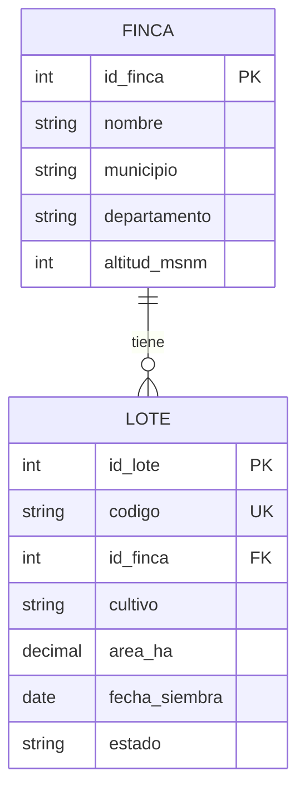
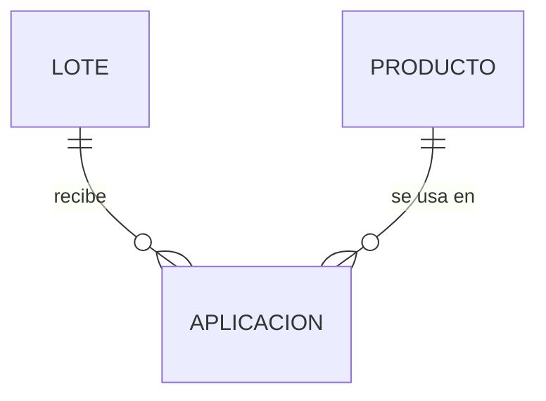
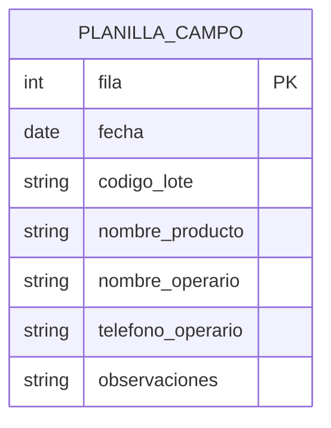
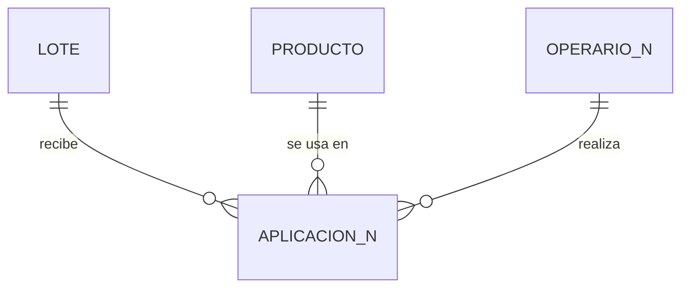
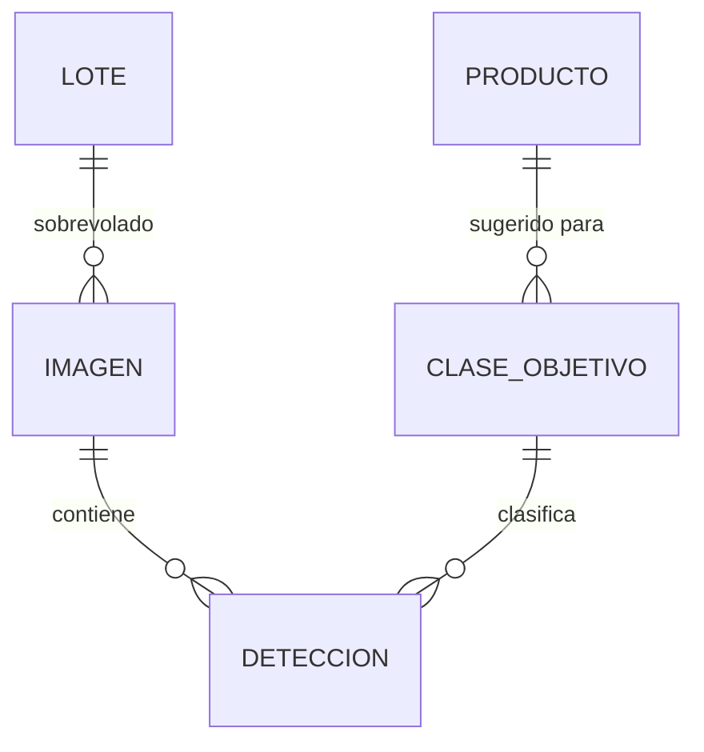

# ACTIVIDAD-8
# 🚜 AgroDatos Lab · Taller de Bases de Datos MySQL

> *"Los datos guardados solo sirven si sabemos hacerles preguntas."*

Taller completo de diseño, normalización y consulta de una base de datos
para una **empresa agrícola colombiana** con fincas en Cundinamarca, Caldas
y Boyacá. Cubre DDL, integridad referencial, DML, normalización hasta 3FN
y visión artificial con YOLO + MySQL.

---

## 👤 Autor

- **Nombre:** Thomas Stev Arismendi
- **Institución:** SENA
- **Programa:** PROGRAMACION DE SOFTWARE
- **Fecha:** Octubre 2026

---

## 🎯 Descripción

La empresa **AgroDatos** necesita registrar:

- **Lotes** divididos por fincas en tres departamentos
- **Insumos** de bodega (fertilizantes, fungicidas, insecticidas, bioinsumos)
  según su **anexo técnico** oficial
- **Aplicaciones** en campo (lote + producto + operario + fecha + cantidad)
- **Detecciones de plagas** realizadas por un dron con **YOLO** (visión artificial)

El proyecto construye paso a paso la base de datos `agro_campo` en MySQL,
con restricciones de integridad, vistas, triggers y consultas que se
convierten en recomendaciones agronómicas.

---

## 🛠️ Tecnologías

| Herramienta | Uso |
|---|---|
| **MySQL 8.0.46** | Motor de base de datos |
| **Google Colab** | Entorno de ejecución |
| **Python 3.13** | Lenguaje anfitrión |
| **PyMySQL** | Conector MySQL ↔ Python |
| **Ultralytics YOLOv8** | Detección de objetos |
| **AgroDatos Lab** | Simulador interactivo (5 laboratorios) |
| **GitHub** | Control de versiones y entrega |

---

## 📂 Estructura del repositorio

```
agro-datos-lab/
├── README.md                    ← este archivo
├── ACTIVIDAD_8_COMPLETA.ipynb       ← cuaderno de Colab con todo el código

```

---

## 📚 Contenido

- [Punto 1 · Modelado y DDL](#punto-1--modelado-y-ddl)
- [Punto 2 · Integridad referencial e insumos](#punto-2--integridad-referencial-e-insumos)
- [Punto 3 · Consultas para tomar decisiones (DML)](#punto-3--consultas-para-tomar-decisiones-dml)
- [Punto 4 · Normalización de una planilla de campo](#punto-4--normalización-de-una-planilla-de-campo)
- [Punto 5 · Visión artificial con YOLO y MySQL](#punto-5--visión-artificial-con-yolo-y-mysql)
- [Punto 6 · Evaluación final](#punto-6--evaluación-final)

---

## Punto 1 · Modelado y DDL

### 1.1 Ejercicio 0 · Verificación del entorno

Se verificó la versión de MySQL y la hora del servidor desde Colab.


### 1.2 Modelo Entidad-Relación

**Entidades principales:**

- **Finca** (`id_finca` PK, nombre, municipio, departamento, altitud_msnm)
- **Lote** (`id_lote` PK, codigo UK, id_finca FK, cultivo, area_ha, fecha_siembra, estado)

**Cardinalidad principal:** Una finca tiene **muchos** lotes; un lote pertenece
a **una sola** finca.



**Práctica en el simulador:** 5/5 en la actividad de cardinalidades del
Laboratorio 1.


### 1.3 Restricciones de la tabla `lote`

| Restricción | Campo | ¿Para qué sirve? |
|---|---|---|
| **PRIMARY KEY** | `id_lote` | Identifica cada lote de forma única e irrepetible. No acepta nulos. |
| **NOT NULL** | `codigo`, `id_finca`, `cultivo`, `area_ha`, `fecha_siembra` | Obliga a que estos campos siempre tengan valor. |
| **UNIQUE** | `codigo` | Evita que dos lotes tengan el mismo código (ej. dos `ESP-L01`). |
| **CHECK** | `area_ha > 0` | Impide registrar áreas negativas o cero. |
| **DEFAULT** | `estado = 'activo'` | Si no se indica estado, se asume `'activo'`. |
| **FOREIGN KEY** | `id_finca` | Garantiza que el lote pertenezca a una finca existente. |

### 1.4 Pruebas de error (celdas 1.4, 1.5, 1.6)

#### 🔴 Prueba 1.4 — Área negativa (CHECK)

```sql
INSERT INTO lote (codigo, id_finca, cultivo, area_ha, fecha_siembra)
VALUES ('TEST-01', 1, 'papa', -5.00, '2025-05-01');
```

**Error:** `(3819, "Check constraint 'chk_area' is violated.")`
**Restricción:** `CHECK (area_ha > 0)`.

#### 🔴 Prueba 1.5 — Código duplicado (UNIQUE)

```sql
INSERT INTO lote (codigo, id_finca, cultivo, area_ha, fecha_siembra)
VALUES ('ESP-L01', 1, 'maíz', 2.00, '2025-05-02');
```

**Error:** `(1062, "Duplicate entry 'ESP-L01' for key 'lote.codigo'")`
**Restricción:** `UNIQUE (codigo)`.

#### 🔴 Prueba 1.6 — Campo obligatorio faltante (NOT NULL)

```sql
INSERT INTO lote (codigo, id_finca, area_ha, fecha_siembra)
VALUES ('TEST-02', 1, 3.00, '2025-05-03');
```

**Error:** `(1364, "Field 'cultivo' doesn't have a default value")`
**Restricción:** `NOT NULL` en `cultivo`.

### 1.5 RETO 1

**a. Columna `tipo_riego`**

```sql
ALTER TABLE lote
ADD COLUMN tipo_riego ENUM('goteo','aspersión','gravedad','secano')
DEFAULT 'secano';
```

**b. Tabla `operario`**

```sql
CREATE TABLE operario (
    id_operario           INT AUTO_INCREMENT PRIMARY KEY,
    documento             VARCHAR(20)  NOT NULL UNIQUE,
    nombre_completo       VARCHAR(120) NOT NULL,
    telefono              VARCHAR(20),
    certificado_aplicador BOOLEAN DEFAULT FALSE
);
```

**c. 3 operarios insertados**

| id | documento | nombre_completo | teléfono | certificado |
|---|---|---|---|---|
| 1 | 1012345678 | Juan Pérez | 3105557788 | TRUE |
| 2 | 1098765432 | María Gómez | 3112223344 | FALSE |
| 3 | 1033445566 | Carlos Rodríguez | 3204445566 | TRUE |

### 1.6 Reflexiones

**7. ¿Por qué `area_ha` es `DECIMAL(6,2)` y no `FLOAT`?**

Porque `FLOAT` guarda **aproximaciones binarias** y puede generar errores de
redondeo (ej. `2.50` se almacenaría como `2.4999999…`). `DECIMAL(6,2)` guarda
el valor **exacto** con 2 decimales, crítico al calcular dosis por hectárea,
rendimientos o costos.

**8. Validar en HTML vs `CHECK` en MySQL**

| Aspecto | HTML | CHECK MySQL |
|---|---|---|
| Dónde valida | Navegador | Motor BD |
| Seguridad | Burlable | Infranqueable |
| Velocidad | Inmediata | Post-envío |

**Conviene hacer ambas:** HTML mejora la UX con feedback inmediato; CHECK
garantiza integridad real aunque alguien salte el frontend.

**9. Desventaja de usar `ENUM` para cultivo**

Si aparece un cultivo nuevo (arroz), hay que hacer `ALTER TABLE` para
modificar el ENUM, lo cual bloquea la tabla y es rígido.

**Alternativa:** tabla catálogo `cultivo (id_cultivo, nombre)` referenciada
por FK desde `lote`. Agregar un cultivo es un simple `INSERT`.

---

## Punto 2 · Integridad referencial e insumos

### 2.1 Foreign Keys y `ON DELETE RESTRICT`

```sql
CREATE TABLE aplicacion (
    id_aplicacion INT AUTO_INCREMENT PRIMARY KEY,
    id_lote       INT NOT NULL,
    id_producto   INT NOT NULL,
    fecha         DATE NOT NULL,
    cantidad      DECIMAL(8,2) NOT NULL,
    CONSTRAINT fk_apl_lote     FOREIGN KEY (id_lote)     REFERENCES lote(id_lote)         ON DELETE RESTRICT,
    CONSTRAINT fk_apl_producto FOREIGN KEY (id_producto) REFERENCES producto(id_producto) ON DELETE RESTRICT,
    CONSTRAINT chk_cantidad    CHECK (cantidad > 0)
);
```

- **`fk_apl_lote`** impide registrar aplicaciones en lotes inexistentes.
- **`fk_apl_producto`** impide aplicar productos que no están en bodega.
- **`ON DELETE RESTRICT`** impide borrar un padre con hijos. Protege
  trazabilidad: no puedes borrar un lote si tiene aplicaciones.

**Relación N:M lote ↔ producto** resuelta con `aplicacion`:



### 2.2 Anexo técnico · 6 productos registrados

| # | Nombre | Tipo | Ingrediente activo | Cat. | ICA | Dosis | Und | Carencia | Reingreso |
|---|---|---|---|---|---|---|---|---|---|
| 1 | NitroCampo 46 | fertilizante | Urea 46 % N | IV | ICA-DEMO-1001 | 150 | kg | 0 | 0 |
| 2 | FosfoArranque | fertilizante | Fosfato diamónico | IV | ICA-DEMO-1002 | 100 | kg | 0 | 0 |
| 3 | CalViva | enmienda | Cal dolomita | IV | ICA-DEMO-1003 | 500 | kg | 0 | 0 |
| 4 | BioLarva WP | bioinsumo | Bacillus thuringiensis | IV | ICA-DEMO-2001 | 0.5 | kg | 0 | 4 |
| 5 | RoyaStop 250 EC | fungicida | Triazol 250 g/L | III | ICA-DEMO-3001 | 0.4 | L | 30 | 24 |
| 6 | TizónFin 80 WP | fungicida | Ditiocarbamato | III | ICA-DEMO-3002 | 2.5 | kg | 14 | 24 |

### 2.3 Pruebas de error

**Error 1 · FK inexistente:**

```sql
INSERT INTO aplicacion (id_lote, id_producto, fecha, cantidad)
VALUES (99, 1, '2026-05-15', 10);
```

**Error:** `(1452, "Cannot add or update a child row: a foreign key constraint fails")`
**Restricción:** `fk_apl_lote` protegió la integridad referencial.

### 2.4 RETO 2A · Insertar productos restantes

```sql
INSERT INTO producto
(nombre_comercial, tipo, ingrediente_activo, categoria_tox, registro_ica,
 dosis_ha, unidad, carencia_dias, reingreso_horas, precio_cop)
VALUES
('BioLarva WP',     'bioinsumo', 'Bacillus thuringiensis var. kurstaki', 'IV',  'ICA-DEMO-2001', 0.5, 'kg', 0,  4,  95000),
('RoyaStop 250 EC', 'fungicida', 'Triazol 250 g/L',                     'III', 'ICA-DEMO-3001', 0.4, 'L',  30, 24, 160000),
('TizónFin 80 WP',  'fungicida', 'Ditiocarbamato 800 g/kg',             'III', 'ICA-DEMO-3002', 2.5, 'kg', 14, 24, 38000);
```

### 2.5 RETO 2B · Subconsulta y `DATE_ADD`

**Aplicación con subconsulta:**

```sql
INSERT INTO aplicacion (id_lote, id_producto, fecha, cantidad)
SELECT
    (SELECT id_lote     FROM lote     WHERE codigo = 'CAF-L01'),
    (SELECT id_producto FROM producto WHERE nombre_comercial = 'RoyaStop 250 EC'),
    '2026-05-10',
    (SELECT dosis_ha FROM producto WHERE nombre_comercial = 'RoyaStop 250 EC') *
    (SELECT area_ha  FROM lote     WHERE codigo = 'CAF-L01');
```

**Consulta con `DATE_ADD`:**

```sql
SELECT a.id_aplicacion, l.codigo AS lote, p.nombre_comercial,
       a.fecha, p.carencia_dias,
       DATE_ADD(a.fecha, INTERVAL p.carencia_dias DAY) AS cosecha_desde
FROM aplicacion a
JOIN lote l     ON l.id_lote = a.id_lote
JOIN producto p ON p.id_producto = a.id_producto
ORDER BY a.fecha;
```

### 2.6 Reflexiones

**7. Error al insertar aplicación en lote 99**

`Error 1452` — el motor rechazó la fila por la llave foránea.
**Sin FK en una web:** se guardarían aplicaciones huérfanas que romperían
reportes y JOINs.

**8. ¿Por qué no se pudo borrar la finca 1?**

Porque `lote` tiene `ON DELETE RESTRICT` referenciando a `finca`, y la finca 1
tiene lotes hijos.

**Caso para `ON DELETE CASCADE`:** al borrar una `imagen`, que se borren
automáticamente sus `detecciones` asociadas (datos derivados que no tienen
sentido sin la imagen).

**9. Categoría toxicológica equivocada aceptada por el motor**

Porque `CHECK` solo verifica que el valor esté dentro del dominio (I, II, III,
IV), pero no puede saber cuál es el correcto para ese producto. La BD no "lee"
el anexo técnico.

**Controles en la web:**
- Validación cruzada contra registro ICA oficial
- Precargar datos del anexo y solo permitir confirmar
- Auditoría con log de usuario/acción/timestamp

**10. Operario entrando al lote 10 h después de RoyaStop**

El dato que debió impedirlo es `reingreso_horas = 24` en la tabla `producto`.

**Cómo mostrarlo en la web:**

```
⛔ ACCESO RESTRINGIDO
Última aplicación: RoyaStop 250 EC · 10/05/2026 08:00
Reingreso permitido a partir de: 11/05/2026 08:00
Faltan: 14 h
```

---

## Punto 3 · Consultas para tomar decisiones (DML)

### 3.1 a 3.4 · Consultas base

| # | Consulta | Pregunta del agrónomo |
|---|---|---|
| 3.1 | INNER JOIN aplicacion + lote + producto | ¿Qué se aplicó en cada lote y cuándo? |
| 3.2 | GROUP BY por lote | ¿Cuánto se ha aplicado en total por lote? |
| 3.3 | LEFT JOIN + WHERE IS NULL | ¿Qué lotes nunca han recibido aplicación? |
| 3.4 | CASE sobredosis/subdosis | ¿Qué aplicaciones están fuera del rango del anexo? |

### 3.2 Expresión CASE de la consulta 3.4

```sql
CASE
    WHEN a.cantidad > l.area_ha * p.dosis_ha * 1.10 THEN 'SOBREDOSIS'
    WHEN a.cantidad < l.area_ha * p.dosis_ha * 0.90 THEN 'SUBDOSIS'
    ELSE 'DOSIS CORRECTA'
END AS diagnostico
```

Compara la **cantidad real aplicada** contra la **dosis esperada**
(área × dosis anexo) y emite diagnóstico con margen de tolerancia ±10 %.

### 3.3 RETO 3

**a. Área total por cultivo:**

```sql
SELECT cultivo, SUM(area_ha) AS area_total
FROM lote GROUP BY cultivo ORDER BY area_total DESC;
```

**b. Fincas con más de 5 ha (HAVING):**

```sql
SELECT f.nombre, SUM(l.area_ha) AS area_total
FROM finca f JOIN lote l ON l.id_finca = f.id_finca
GROUP BY f.id_finca, f.nombre
HAVING SUM(l.area_ha) > 5
ORDER BY area_total DESC;
```

**c. Productos sin aplicación:**

```sql
SELECT p.nombre_comercial FROM producto p
LEFT JOIN aplicacion a ON a.id_producto = p.id_producto
WHERE a.id_aplicacion IS NULL;
```

**d. Operario top en kg de fertilizante:**

```sql
SELECT o.nombre_completo, SUM(a.cantidad) AS kg_aplicados
FROM aplicacion a
JOIN operario o ON o.id_operario = a.id_operario
JOIN producto p ON p.id_producto = a.id_producto
WHERE p.tipo = 'fertilizante' AND p.unidad = 'kg'
GROUP BY o.id_operario, o.nombre_completo
ORDER BY kg_aplicados DESC LIMIT 1;
```

### 3.4 Práctica en simulador · Laboratorio 4

6 retos resueltos correctamente. Errores de FK y CHECK comparados con MySQL.


### 3.5 Reflexiones

**5. LEFT JOIN vs JOIN en 3.3**

Con `INNER JOIN` la consulta devolvería 0 filas (por el `WHERE IS NULL`).
El `LEFT JOIN` conserva todos los lotes y rellena con NULL los sin aplicación.
Es la técnica **anti-join** para encontrar "lo que falta".

**6. ¿Por qué `GROUP BY l.codigo, l.cultivo` además de `l.id_lote`?**

Porque en MySQL 8 con `ONLY_FULL_GROUP_BY` (por defecto), toda columna del
SELECT que no esté en función de agregado debe declararse en el GROUP BY.
`l.codigo` y `l.cultivo` no son agregados → van obligatoriamente.

**7. Costo por hectárea: SQL o JavaScript**

**Conviene SQL:**
- **Transferencia:** traer 10.000 filas al navegador vs devolver solo el resumen
- **Seguridad:** JS expone datos crudos; SQL filtra por rol
- **Consistencia:** todos los usuarios ven el mismo cálculo

**Excepción:** cálculos interactivos (sliders) pueden precalcular en SQL y
ajustar deltas en JS.

---

## Punto 4 · Normalización de una planilla de campo

### 4.1 Anomalías detectadas en `planilla_campo`

- **Actualización:** operario `1012345678` con dos teléfonos distintos
  (filas 1-4 con `3105557788`, fila 7 con `9999999999`)
- **Inserción:** no se puede registrar un operario sin asignarle una aplicación
- **Borrado:** al borrar la única aplicación de `BioLarva WP`, se pierde toda
  la información del producto

### 4.2 Consulta de auditoría

```sql
SELECT documento_operario, nombre_operario,
       COUNT(DISTINCT telefono_operario) AS num_telefonos,
       GROUP_CONCAT(DISTINCT telefono_operario) AS telefonos
FROM planilla_campo
GROUP BY documento_operario, nombre_operario
HAVING COUNT(DISTINCT telefono_operario) > 1;
```

Detecta la **huella digital de la anomalía de actualización**: un dato repetido
que cambia solo en algunas filas.

### 4.3 Dependencia transitiva eliminada

En la planilla: `fila → documento_operario → nombre_operario, telefono`

Al crear `operario_n` con `documento` como PK, los datos del operario viven en
**un solo lugar** y se referencian por FK. **3FN alcanzada.**

### 4.4 RETO 4

**a. Tabla `aplicacion_n` en 3FN:**

```sql
CREATE TABLE aplicacion_n (
    id_aplicacion      INT AUTO_INCREMENT PRIMARY KEY,
    fecha              DATE NOT NULL,
    id_lote            INT NOT NULL,
    id_producto        INT NOT NULL,
    cantidad           DECIMAL(8,2) NOT NULL,
    documento_operario VARCHAR(20),
    observaciones      TEXT,
    CONSTRAINT fk_apln_lote     FOREIGN KEY (id_lote)            REFERENCES lote(id_lote),
    CONSTRAINT fk_apln_producto FOREIGN KEY (id_producto)        REFERENCES producto(id_producto),
    CONSTRAINT fk_apln_operario FOREIGN KEY (documento_operario) REFERENCES operario_n(documento)
);
```

**b. Migración con INSERT … SELECT:**

```sql
INSERT INTO aplicacion_n
(fecha, id_lote, id_producto, cantidad, documento_operario, observaciones)
SELECT p.fecha, l.id_lote, pr.id_producto, p.cantidad_aplicada,
       p.documento_operario, p.observaciones
FROM planilla_campo p
JOIN lote l      ON l.codigo           = p.codigo_lote
JOIN producto pr ON pr.nombre_comercial = p.nombre_producto;
```

**c. Reconstrucción de la planilla:**

```sql
SELECT a.fecha, l.codigo AS codigo_lote, l.cultivo, l.area_ha,
       p.nombre_comercial, p.tipo, p.categoria_tox,
       p.dosis_ha, p.unidad, p.carencia_dias, p.reingreso_horas,
       a.cantidad, o.documento, o.nombre_completo, o.telefono,
       a.observaciones
FROM aplicacion_n a
JOIN lote l       ON l.id_lote     = a.id_lote
JOIN producto p   ON p.id_producto = a.id_producto
JOIN operario_n o ON o.documento   = a.documento_operario
ORDER BY a.fecha;
```

### 4.5 Modelo E-R antes y después

**Antes (planilla plana):**



**Después (3FN):**



### 4.6 Reflexiones

**6. ¿De qué depende `categoria_tox`?**

Del **producto**, no de la aplicación. Violaba **2FN** (dependencia parcial):
`categoria_tox` no dependía de la PK de la aplicación, sino del producto.

**7. ¿`observaciones` cumple 1FN?**

**No**, contiene valores no atómicos (`"cogollero en 30% de plantas"` mezcla
tipo, porcentaje y unidad).

**Rediseño:**

```sql
CREATE TABLE observacion_plaga (
    id_observacion INT AUTO_INCREMENT PRIMARY KEY,
    id_aplicacion  INT NOT NULL,
    plaga          VARCHAR(50),
    porcentaje     DECIMAL(5,2),
    unidad         VARCHAR(20),
    nota_libre     TEXT,
    FOREIGN KEY (id_aplicacion) REFERENCES aplicacion_n(id_aplicacion)
);
```

**8. ¿Cuándo desnormalizar a propósito?**

Cuando la **performance de lectura** importa más que la consistencia perfecta.
Ejemplo: dashboards con miles de consultas diarias → tabla de resumen
precalculada. **Regla:** es una decisión consciente y documentada, no un
accidente.

---

## Punto 5 · Visión artificial con YOLO y MySQL

### 5.1 Modelo E-R de visión artificial



**¿Por qué `deteccion` no guarda `codigo_lote`?**

Porque ya lo tiene vía `imagen.id_lote`. Guardarlo sería redundante (viola 3FN)
y crearía una anomalía de actualización. Se obtiene con JOIN cuando se necesite.

### 5.2 YOLO real · Detecciones guardadas

Con `SUBIR_FOTO = True` se subió una imagen y se guardaron las detecciones en
`imagen` y `deteccion` (coordenadas normalizadas 0-1).

**Nota:** el modelo COCO detectó clases genéricas (broccoli, person...) porque
no conoce plagas reales. Para producción se necesita un modelo entrenado.

### 5.3 Simulación de 30 vuelos

- **Imágenes guardadas:** 30
- **Detecciones guardadas:** *(ver captura)*
- **Modelo:** `yolo-agro-v1`

### 5.4 Vista `v_recomendacion`

```sql
CREATE OR REPLACE VIEW v_recomendacion AS
SELECT l.codigo AS lote, l.cultivo, l.area_ha,
       d.clase, c.umbral_dano,
       COUNT(*) AS detecciones,
       ROUND(COUNT(*) / l.area_ha, 2) AS densidad_por_ha,
       c.producto_sugerido, p.dosis_ha, p.unidad,
       ROUND(p.dosis_ha * l.area_ha, 2) AS cantidad_bodega,
       p.carencia_dias, p.reingreso_horas
FROM deteccion d
JOIN imagen i          ON i.id_imagen = d.id_imagen
JOIN lote l            ON l.id_lote = i.id_lote
JOIN clase_objetivo c  ON c.clase = d.clase
LEFT JOIN producto p   ON p.id_producto = c.id_producto
WHERE d.confianza >= 0.5
GROUP BY l.codigo, l.cultivo, l.area_ha, d.clase, c.umbral_dano,
         c.producto_sugerido, p.dosis_ha, p.unidad,
         p.carencia_dias, p.reingreso_horas;
```

### 5.5 TRIGGER `trg_alerta_plaga`

```sql
CREATE TRIGGER trg_alerta_plaga
AFTER INSERT ON deteccion
FOR EACH ROW
BEGIN
    DECLARE v_lote VARCHAR(20);
    DECLARE v_umbral INT;
    DECLARE v_total INT;

    IF NEW.confianza >= 0.75 THEN
        SELECT l.codigo INTO v_lote
        FROM imagen i JOIN lote l ON l.id_lote = i.id_lote
        WHERE i.id_imagen = NEW.id_imagen;

        SELECT umbral_dano INTO v_umbral
        FROM clase_objetivo WHERE clase = NEW.clase;

        SELECT COUNT(*) INTO v_total
        FROM deteccion d JOIN imagen i ON i.id_imagen = d.id_imagen
        WHERE i.id_imagen = NEW.id_imagen
          AND d.clase = NEW.clase AND d.confianza >= 0.5;

        IF v_total > v_umbral THEN
            INSERT INTO alerta_plaga (id_deteccion, clase, lote_codigo, mensaje)
            VALUES (NEW.id_deteccion, NEW.clase, v_lote,
                    CONCAT('Alerta: ', NEW.clase, ' en lote ', v_lote,
                           ' (', v_total, ' detecciones, umbral ', v_umbral, ')'));
        END IF;
    END IF;
END;
```

**Explicación línea por línea:**

- `AFTER INSERT ON deteccion` → se dispara al insertar una detección
- `FOR EACH ROW` → una vez por fila
- `IF NEW.confianza >= 0.75` → solo actúa si la confianza es alta
- Obtiene código del lote vía JOIN `deteccion → imagen → lote`
- Obtiene umbral de daño desde `clase_objetivo`
- Cuenta detecciones válidas (confianza ≥ 0.5) de esa clase en esa imagen
- Si supera el umbral, inserta alerta en `alerta_plaga`

### 5.6 RETO 5

**a. Tendencia por lote y semana:**

```sql
SELECT l.codigo AS lote, YEARWEEK(i.fecha_hora, 1) AS semana,
       d.clase, COUNT(*) AS detecciones_validas
FROM deteccion d
JOIN imagen i ON i.id_imagen = d.id_imagen
JOIN lote l   ON l.id_lote = i.id_lote
WHERE d.confianza >= 0.5 AND d.clase <> 'maleza'
GROUP BY l.codigo, semana, d.clase
ORDER BY l.codigo, semana;
```

**b. Densidad por hectárea:**

```sql
SELECT l.codigo, l.cultivo, l.area_ha, d.clase,
       COUNT(*) AS detecciones,
       ROUND(COUNT(*) / l.area_ha, 2) AS por_hectarea
FROM deteccion d
JOIN imagen i ON i.id_imagen = d.id_imagen
JOIN lote l   ON l.id_lote = i.id_lote
WHERE d.confianza >= 0.5 AND d.clase <> 'maleza'
GROUP BY l.codigo, l.cultivo, l.area_ha, d.clase
ORDER BY por_hectarea DESC;
```

**c. Calidad con distintos umbrales:**

```sql
SELECT
    SUM(CASE WHEN confianza >= 0.30 THEN 1 ELSE 0 END) AS umbral_030,
    SUM(CASE WHEN confianza >= 0.45 THEN 1 ELSE 0 END) AS umbral_045,
    SUM(CASE WHEN confianza >= 0.60 THEN 1 ELSE 0 END) AS umbral_060,
    SUM(CASE WHEN confianza >= 0.75 THEN 1 ELSE 0 END) AS umbral_075
FROM deteccion WHERE clase = 'maleza';
```

**d. Comparar versiones del modelo:**

```sql
ALTER TABLE deteccion
ADD COLUMN modelo VARCHAR(40) DEFAULT 'yolo11n-agro-v1';

SELECT modelo, clase, COUNT(*) AS detecciones,
       ROUND(AVG(confianza), 3) AS confianza_promedio
FROM deteccion
GROUP BY modelo, clase
ORDER BY clase, modelo;
```

### 5.7 Práctica en simulador · Laboratorio 3

3 vuelos sobre lotes de diferentes cultivos. Tabla registrada:

| Lote | Cultivo | Umbral | Precisión | Recall |
|---|---|---|---|---|
| ESP-L01 | papa | 0.25 | *(ver captura)* | *(ver captura)* |
| ESP-L01 | papa | 0.45 | *(ver captura)* | *(ver captura)* |
| ESP-L01 | papa | 0.80 | *(ver captura)* | *(ver captura)* |


### 5.8 Reflexiones

**8. Clasificación vs detección**

- **Clasificación:** una etiqueta para toda la imagen
- **Detección:** qué + dónde, para cada objeto

Para contar gusanos por planta se necesita **detección**: necesitas saber
cuántos hay y dónde están
